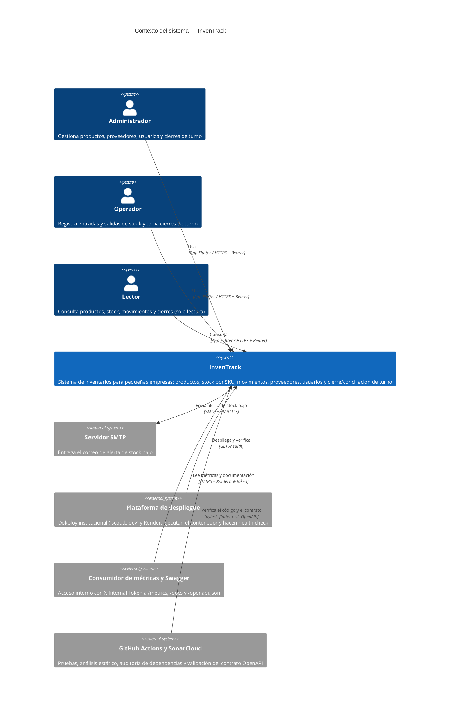

# Nivel 1 · Diagrama de contexto

## Actores y permisos (según `permitido()` en `app/usuarios/infrastructure/credenciales.py`)

| Rol | Lectura (GET) | Escritura |
|---|---|---|
| `admin` | Todo | Todo, incluida la administración de `/usuarios` |
| `operador` | Todo menos `/usuarios` | Solo `POST` en `/inventario` y `/cierres` |
| `lector` | Todo menos `/usuarios` | Nada |

## Notas

- En el perfil demo (sin `INVENTRACK_DB_PATH`) no hay autenticación y `/usuarios` responde 403.
- En producción, las rutas de negocio responden 503 hasta que existan base de datos y `INVENTRACK_ALLOW_BUSINESS_DATA=true`.
- El SMTP es opcional: sin `INVENTRACK_SMTP_HOST/DE/PARA` no se arranca el envío de correos.
