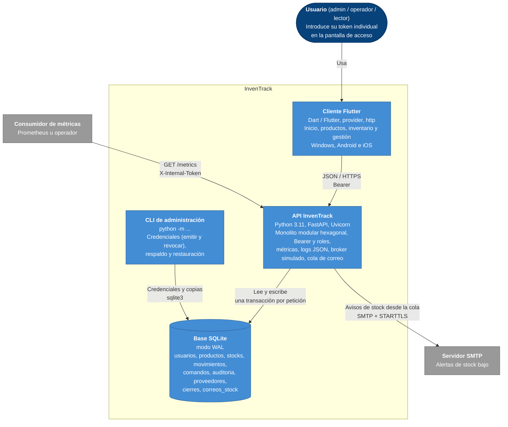

# Nivel 2 · Diagrama de contenedores

## Contenedores

| Contenedor | Tecnología | Evidencia en el repo |
|---|---|---|
| Cliente Flutter | Flutter, `provider`, `http`, `google_fonts`, `intl` | `frontend/pubspec.yaml`, `frontend/lib/services/api_service.dart` |
| API InvenTrack | FastAPI, imagen `python:3.11-slim`, usuario no root, puerto 10000 | `Dockerfile`, `app/main.py` |
| Base SQLite | Archivo único en volumen persistente `/app/data/inventrack.sqlite3` | `deploy/compose.lab.yaml`, `app/shared/infrastructure/sqlite.py` |
| CLI de administración | Módulos Python ejecutables dentro del mismo servicio y volumen | `credenciales.py`, `respaldo.py` |

## Perfiles de ejecución de la API

| Perfil | Condición | Persistencia | Autenticación |
|---|---|---|---|
| Demo | Sin `INVENTRACK_DB_PATH` | Repositorios en memoria | Ninguna |
| Durable | Con `INVENTRACK_DB_PATH` | SQLite | Bearer individual + roles |
| Producción cerrada | `INVENTRACK_ENV=production` sin `INVENTRACK_ALLOW_BUSINESS_DATA=true` | — | Rutas de negocio devuelven 503 |

## Endpoints expuestos por la API

`/health`, `/`, `/metrics`*, `/docs`*, `/redoc`*, `/openapi.json`*, `/sesion`, `/usuarios`, `/productos`, `/proveedores`, `/cierres`, `/inventario/{id}/entradas`, `/inventario/{id}/salidas`, `/inventario/{id}` y `/inventario/{id}/movimientos`.

\* Devuelven 404 en producción sin `X-Internal-Token` válido.
