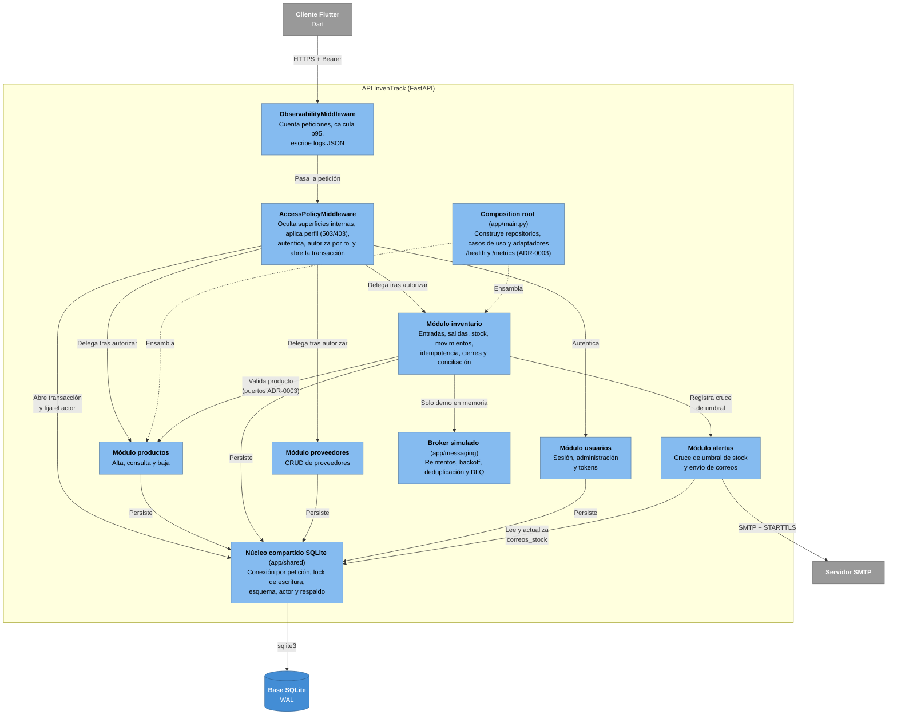
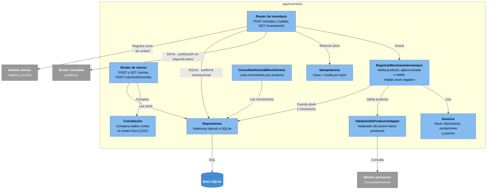
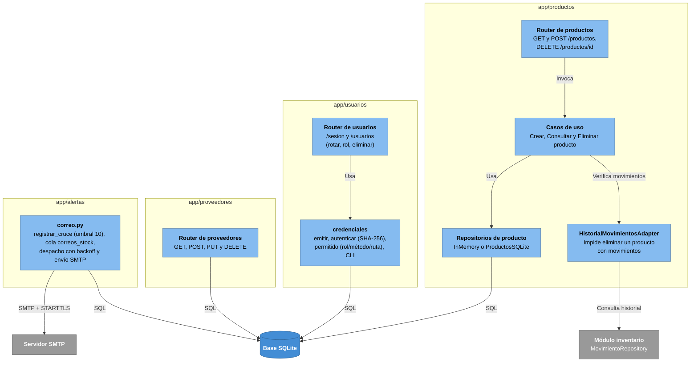
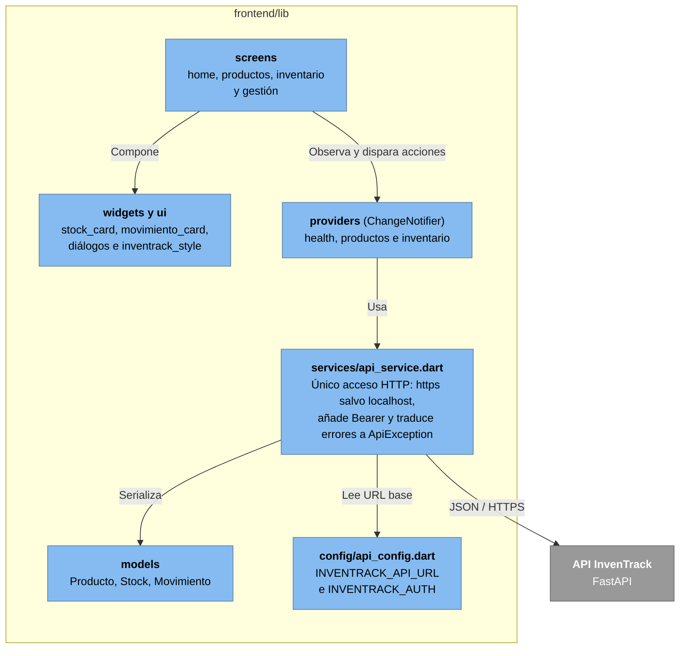

# Nivel 3 · Diagramas de componentes

## 3.1 API: middleware, composition root y módulos

## 3.2 Módulo inventario

## 3.3 Módulos productos, usuarios, proveedores y alertas

## 3.4 Cliente Flutter

