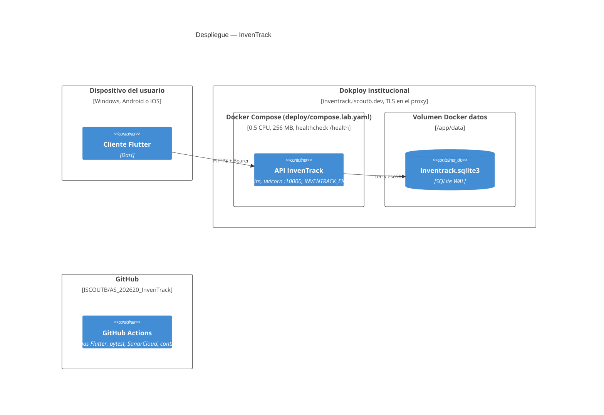

# Complementario · Despliegue

## Configuración por entorno

| Variable | Dokploy (compose) |
|---|---|
| `INVENTRACK_ENV` | `production` |
| `INVENTRACK_DB_PATH` | `/app/data/inventrack.sqlite3` |
| `INVENTRACK_ALLOW_BUSINESS_DATA` | `false` por defecto; `true` para activar el negocio |
| `INVENTRACK_INTERNAL_TOKEN` | obligatorio |
| `INVENTRACK_SMTP_*` | opcionales (HOST, PUERTO, DE, PARA, USUARIO, CLAVE) |

## Estado verificable desde el repositorio

- La sonda institucional obtuvo 200 en `/health` y 401 sin credencial en `/sesion`. [Resultados](../docs/verificacion-final.md#verificación-pública-y-colaboración).
