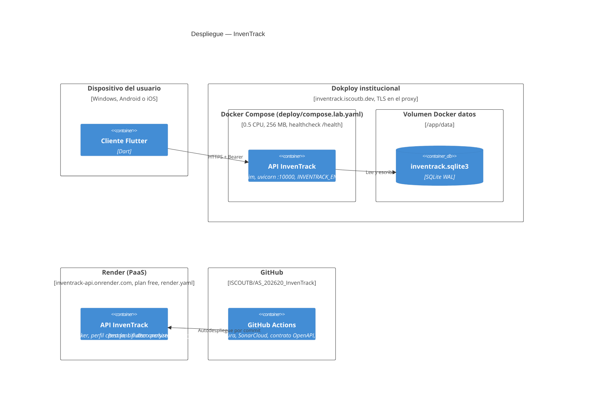

# Complementario · Despliegue

## Configuración por entorno

| Variable | Dokploy (compose) | Render |
|---|---|---|
| `INVENTRACK_ENV` | `production` | `production` |
| `INVENTRACK_DB_PATH` | `/app/data/inventrack.sqlite3` | no definida |
| `INVENTRACK_ALLOW_BUSINESS_DATA` | `false` por defecto; `true` para activar el negocio | `false` |
| `INVENTRACK_INTERNAL_TOKEN` | obligatorio | no definida (docs y métricas ocultas) |
| `INVENTRACK_SMTP_*` | opcionales (HOST, PUERTO, DE, PARA, USUARIO, CLAVE) | no definidas |

## Estado verificable desde el repositorio

- Dokploy: el README documenta `/health` = 200 y `/sesion` = 404 en la última comprobación, es decir, el despliegue público aún no incluye las rutas de Gestión.
- Render: solo ofrece el perfil cerrado; las rutas de negocio responden 503.
- `deploy.yml` es un respaldo manual hacia Azure App Service (imagen en GHCR); no es el despliegue principal.
