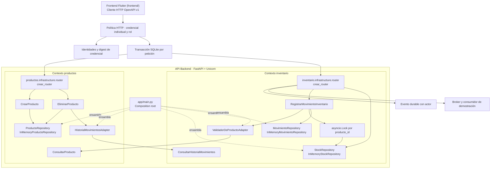

# C4 Nivel 3: Diagrama de Componentes — API Backend InvenTrack

Este nivel abre el contenedor `API Backend` del [C4 Nivel 2](containers.md) y
muestra los componentes implementados actualmente. Los módulos `proveedores` y `alertas` todavía no tienen componentes de código.

## Correspondencia con el código

| Componente | Implementación actual |
|---|---|
| Router de productos | `app/productos/infrastructure/router.py` |
| Casos de uso de productos | `CrearProducto`, `ConsultarProducto`, `EliminarProducto` |
| Repositorio de productos | `InMemoryProductoRepository` |
| Router de inventario | `app/inventario/infrastructure/router.py` |
| Registro de movimientos | `RegistrarMovimientoInventario` |
| Consulta de historial | `ConsultarHistorialMovimientos` |
| Repositorios de inventario | `InMemoryStockRepository`, `InMemoryMovimientoRepository` |
| Integración entre contextos | `HistorialMovimientosAdapter`, `ValidadorDeProductoAdapter` |
| Contrato de API | Interfaz REST formalizada en `docs/api/inventrack-contrato.md` y `contracts/openapi/v1.json` |
| Cliente Flutter | [`frontend/`](../../frontend/) (`ApiService`, providers y pantallas Material 3 sobre OpenAPI v1) |
| Composición | `app/main.py` |

## Reglas de dependencia

- Los routers reciben sus dependencias desde `app/main.py`.
- Los casos de uso dependen de puertos y dominio, no de FastAPI.
- `HistorialMovimientosAdapter` consume `ConsultarHistorialMovimientos`.
- `ValidadorDeProductoAdapter` consume `ConsultarProducto`.
- `asyncio.Lock` se crea dentro de `RegistrarMovimientoInventario` y se mantiene por `producto_id` para serializar movimientos del mismo producto (`ADR-0002`).
- Las respuestas y esquemas de los routers se adhieren al [Contrato de API de InvenTrack](../api/inventrack-contrato.md) (`ADR-0004`).
- Los adaptadores de almacenamiento se seleccionan al iniciar la API según [ADR-0020](../adr/0020-persistir-inventario-y-auditoria-en-sqlite.md).

## Alcance actual y objetivo

El diagrama representa el estado implementado del backend (`app/`), consumido por el cliente Flutter ([`frontend/`](../../frontend/)) sin salir de `contracts/openapi/v1.json`. El perfil durable sustituye los repositorios en memoria por ProductosSQLite, StockSQLite y MovimientosSQLite. El componente de usuarios valida credenciales individuales. Alertas y proveedores siguen como objetivos.