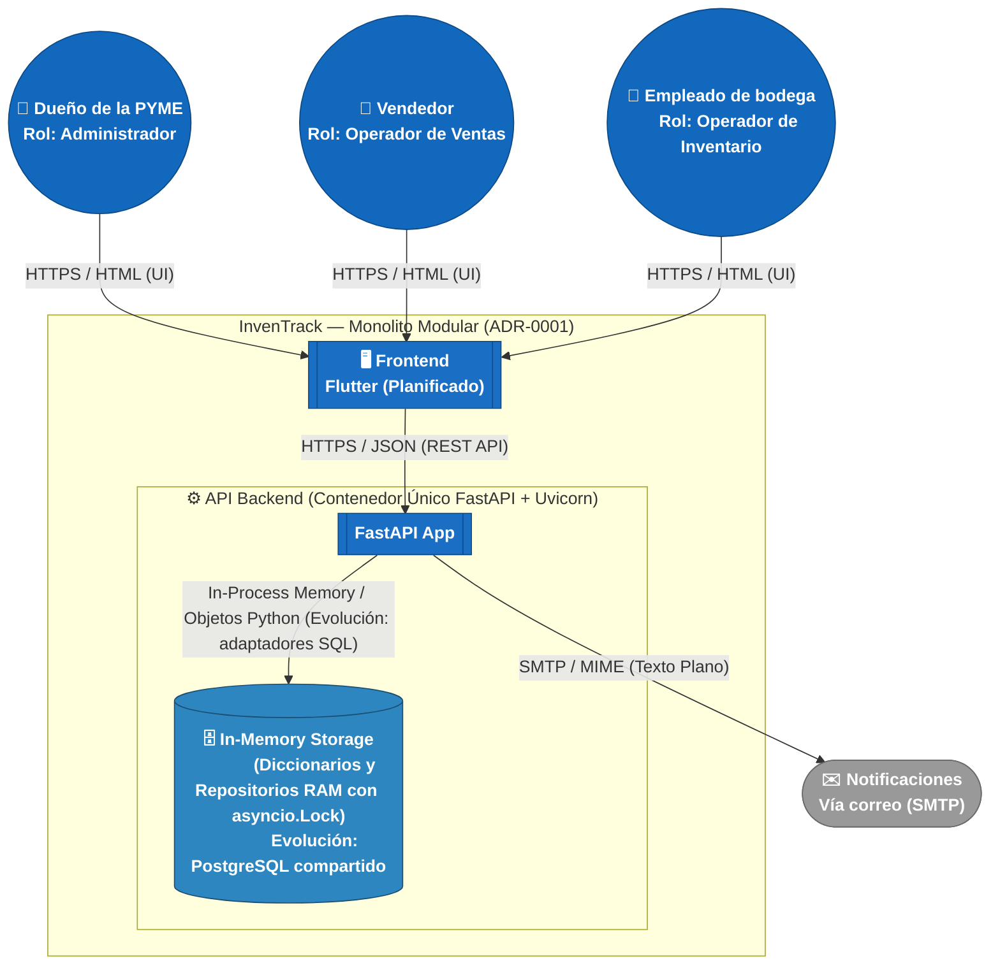
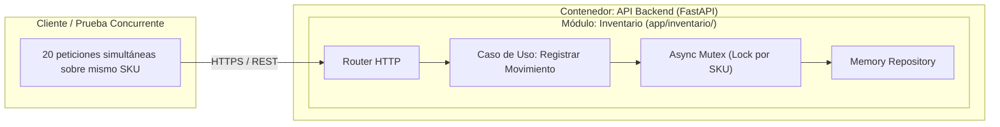

# C4 Nivel 2 — Diagrama de Contenedores — InvenTrack

## Qué muestra este nivel y por qué

El Nivel 2 abre la caja que en el Nivel 1 (`docs/c4/context.md`) era "InvenTrack" y muestra los **contenedores**: unidades que se pueden ejecutar o desplegar por separado (una aplicación, una API, una base de datos). "Contenedor" aquí es un término de C4, **no** de Docker — no implica necesariamente contenedorización.

Los tres actores (Dueño, Vendedor, Empleado de bodega) y sus roles son los mismos del Nivel 1; no se repiten explicaciones aquí, solo el diagrama y lo que cambia al entrar al sistema.

## Leyenda

| Símbolo | Forma | Color (hex) | Significado |
|---|---|---|---|
| 👤 | Círculo doble | Azul medio `#1168bd` | **Persona** — igual que en el Nivel 1 |
| 🖥️ / ⚙️ | Rectángulo de doble borde | Azul contenedor `#1a6fc4` | **Contenedor de aplicación** — algo que se ejecuta (web o API) |
| 🗄️ | Cilindro (persistencia) | Azul base de datos `#2e86c1` | **Almacenamiento Interno** — Repositorios *In-Memory* que residen estrictamente **dentro del espacio de proceso del contenedor API Backend** (no es un contenedor ni servidor de base de datos externo separado); una base relacional compartida es la evolución preferida según [ADR-0012](../adr/0012-mantener-repositorios-en-memoria-en-el-mvp.md). |
| ✉️ | Óvalo (estadio) | Gris `#999999` | **Externo** — igual que en el Nivel 1 |

---

## Por qué solo 3 contenedores (y no 5, uno por módulo)

El [ADR-0001](../adr/0001-usar-monolito-modular-con-hexagonal-por-modulo.md) decide explícitamente un **Monolito Modular**: un único proceso desplegado, no servicios separados. Por eso los cinco módulos funcionales (`productos`, `proveedores`, `inventario`, `usuarios`, `alertas`) **no aparecen como contenedores independientes** — todos viven *dentro* del mismo contenedor "API Backend". Esa separación por módulo se documentará en el **Nivel 3 (Componentes)**, que abre la caja de "API Backend" y sí muestra cada módulo como una unidad propia.

Si en el futuro el equipo decide extraer algún módulo a su propio servicio (por ejemplo, si `inventario` creciera mucho en tráfico), ahí sí aparecería como un cuarto contenedor — pero hoy, con el ADR-0001 vigente, no es el caso.

---

## Correspondencia con la estructura de código

| Contenedor en el diagrama | Corresponde a | Estado |
|---|---|---|
| API Backend | Toda la carpeta [`app/`](../../app/) — un único proceso FastAPI que ensambla los módulos en `app/main.py`. Expone la interfaz pública descrita en el [Contrato de API de InvenTrack](../api/inventrack-contrato.md). | Funcional con cortes verticales en [`app/productos/`](../../app/productos/) y [`app/inventario/`](../../app/inventario/) (Arquitectura Hexagonal + Mutex para concurrencia) |
| Frontend | Aún no existe en el repositorio | Flutter planificado como aplicación cliente; pendiente de implementación |
| Persistencia | Repositorios de productos e inventario | **Actual:** adaptadores *In-Memory* alojados estrictamente dentro del espacio de proceso y memoria RAM del contenedor FastAPI (no es un contenedor externo). **Evolución preferida:** evaluar e implementar una base relacional compartida mediante los mismos puertos, preservando la propiedad por módulo ([ADR-0012](../adr/0012-mantener-repositorios-en-memoria-en-el-mvp.md)). |

---

## Evolución del Contenedor Backend: Línea Base vs. Estado Post-Reto (Corte 1)

Para dar cumplimiento a los criterios de evaluación del Reto del Primer Corte, se documenta la evolución interna del contenedor **API Backend (FastAPI)** frente al escenario de contención simultánea (**ESC-01 / ESC-04**):

### Diagnóstico Técnico Integrado

* **Síntoma:** Stock negativo o datos descuadrados ante solicitudes simultáneas sobre el mismo producto.
* **Causa Raíz:** Ausencia de exclusión mutua / serialización asíncrona sobre el repositorio en memoria.
* **Riesgo Prioritario:** Pérdida de integridad transaccional en la cifra de inventarios del negocio.

### Comparativa de Estado

| Aspecto | Línea Base (Estado Inicial) | Estado Posterior al Reto (Corte 1) |
|---|---|---|
| **Mecanismo de Concurrencia** | Sin aislamiento explícito en memoria. | Exclusión mutua asíncrona serializada por SKU mediante `asyncio.Lock()`. |
| **Garantía de Consistencia** | Vulnerable a *race conditions* y stock negativo ante peticiones simultáneas. | Operación atómica garantizada en el módulo `inventario` [ADR-0002](../adr/0002-control-concurrencia-memoria-inventario.md). |
| **Rendimiento Medido ($p95$)** | Sin validación de latencia bajo contención. | **$p95 = 28\text{ ms}$** (cumple umbral $\le 400\text{ ms}$ con 20 req/s simultáneas). |
| **Degradación Controlada** | Riesgo de bloqueo indebido o crash. | Encolamiento en *event loop*; si la espera por el lock supera el umbral, responde HTTP `503 Service Unavailable` sin corromper el stock (especificado en el [Contrato de API](../api/inventrack-contrato.md)). |
| **Fronteras Modulares** | Definidas en el esqueleto. | Conservadas intactas en `app/inventario/` sin impactar otros módulos. |

### Diagrama de Aislamiento en el Contenedor Backend

## Estado y evolución

- **Contrato de API:** Documentado y formalizado en [Contrato de API de InvenTrack](../api/inventrack-contrato.md) e implementado técnicamente bajo OpenAPI en `contracts/openapi/v1.json`.
- **Nivel 3 (Componentes):** Está documentado en [components.md](components.md) y refleja los componentes implementados de `productos` e `inventario`.
- **Interfaz web:** Flutter está planificado, pero todavía no existe en el repositorio.
- **Persistencia:** actualmente solo existen adaptadores in-memory. La evolución preferida es evaluar una base relacional compartida; cualquier alternativa requiere una decisión sucesora que considere operación, concurrencia, migraciones y recuperación ([ADR-0012](../adr/0012-mantener-repositorios-en-memoria-en-el-mvp.md)).
- **Notificaciones y módulos restantes:** `alertas`, `usuarios` y `proveedores` están definidos como extensiones futuras.

### Delimitación de Fronteras de Almacenamiento (C4 Nivel 2)

- **Contenedor Único API (FastAPI / Uvicorn):** Proceso ejecutable que aloja toda la lógica del monolito modular.
- **In-Memory Storage (Almacén Primario RAM):** Los repositorios de datos **no** constituyen un servidor ni un contenedor de base de datos independiente (como un proceso PostgreSQL o Redis separado en red). Residencialmente viven **dentro del mismo proceso y espacio de memoria RAM del Contenedor FastAPI**, delimitando con absoluta precisión las fronteras de infraestructura del MVP.