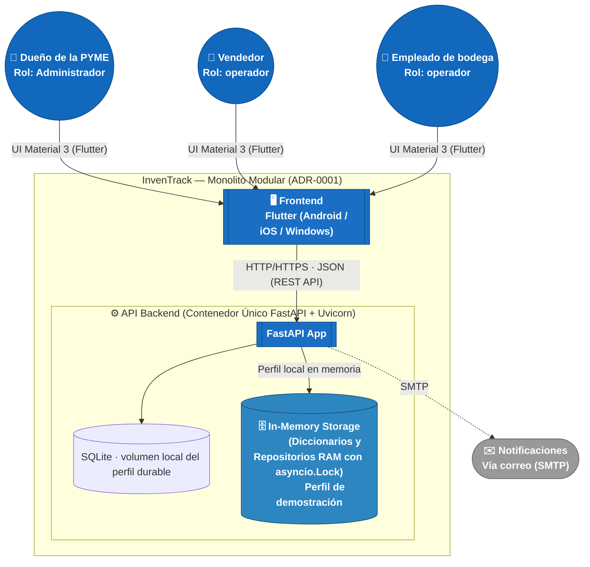
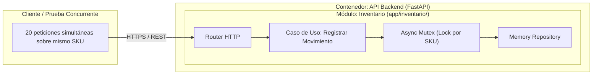

# C4 Nivel 2 — Diagrama de Contenedores — InvenTrack

## Qué muestra este nivel y por qué

El Nivel 2 abre la caja que en el Nivel 1 (`docs/c4/context.md`) era "InvenTrack" y muestra los **contenedores**: unidades que se pueden ejecutar o desplegar por separado (una aplicación, una API, una base de datos). "Contenedor" aquí es un término de C4, **no** de Docker — no implica necesariamente contenedorización.

Los tres actores (Dueño, Vendedor, Empleado de bodega) y sus roles son los mismos del Nivel 1; no se repiten explicaciones aquí, solo el diagrama y lo que cambia al entrar al sistema.

## Leyenda

| Símbolo | Forma | Color (hex) | Significado |
|---|---|---|---|
| 👤 | Círculo doble | Azul medio `#1168bd` | **Persona** — igual que en el Nivel 1 |
| 🖥️ / ⚙️ | Rectángulo de doble borde | Azul contenedor `#1a6fc4` | **Contenedor de aplicación** — algo que se ejecuta (web o API) |
| 🗄️ | Cilindro (persistencia) | Azul base de datos `#2e86c1` | El perfil durable almacena los datos en un archivo SQLite del volumen montado. El perfil de demostración los guarda en RAM dentro del proceso FastAPI. [ADR-0020](../adr/0020-persistir-inventario-y-auditoria-en-sqlite.md). |
| ✉️ | Óvalo (estadio) | Gris `#999999` | **Externo** — igual que en el Nivel 1 |

---

## Fronteras de ejecución

Flutter se ejecuta en el dispositivo del usuario. FastAPI sirve a los clientes desde un único proceso. SQLite es un archivo del volumen de la API en el perfil durable. El diagrama de [componentes](components.md) muestra cómo se conectan los módulos dentro del proceso.

---

## Correspondencia con la estructura de código

| Contenedor en el diagrama | Corresponde a | Estado |
|---|---|---|
| API Backend | Toda la carpeta [`app/`](../../app/) — un único proceso FastAPI que ensambla los módulos en `app/main.py`. Expone la interfaz pública descrita en el [Contrato de API de InvenTrack](../api/inventrack-contrato.md). | Funcional con cortes verticales en [`app/productos/`](../../app/productos/) y [`app/inventario/`](../../app/inventario/) (Arquitectura Hexagonal + Mutex para concurrencia) |
| Frontend | Carpeta [`frontend/`](../../frontend/) — aplicación Flutter (`lib/main.dart`, `lib/services/api_service.dart`, `lib/providers/`, `lib/screens/`) | Implementado para los endpoints del contrato OpenAPI v1 (`health`, `productos`, `inventario`) con runners móviles `android/` e `ios/` y pruebas `MockClient` |
| Persistencia | Catálogo, stock, movimientos, respuestas idempotentes y auditoría | El perfil durable usa SQLite en un volumen local. La demostración usa memoria. [ADR-0020](../adr/0020-persistir-inventario-y-auditoria-en-sqlite.md). |

---

## Evolución del Contenedor Backend: Línea Base vs. Estado Post-Reto (Corte 1)

Para dar cumplimiento a los criterios de evaluación del Reto del Primer Corte, se documenta la evolución interna del contenedor **API Backend (FastAPI)** frente al escenario de contención simultánea (**ESC-01 / ESC-04**):

### Diagnóstico Técnico Integrado

* **Síntoma:** Stock negativo o datos descuadrados ante solicitudes simultáneas sobre el mismo producto.
* **Causa Raíz:** Ausencia de exclusión mutua / serialización asíncrona sobre el repositorio en memoria.
* **Riesgo Prioritario:** Pérdida de integridad transaccional en la cifra de inventarios del negocio.

### Comparativa de Estado

| Aspecto | Línea Base (Estado Inicial) | Estado Posterior al Reto (Corte 1) |
|---|---|---|
| **Mecanismo de Concurrencia** | Sin aislamiento explícito en memoria. | Exclusión mutua asíncrona serializada por SKU mediante `asyncio.Lock()`. |
| **Garantía de Consistencia** | Vulnerable a *race conditions* y stock negativo ante peticiones simultáneas. | Operación atómica garantizada en el módulo `inventario` [ADR-0002](../adr/0002-control-concurrencia-memoria-inventario.md). |
| **Rendimiento Medido ($p95$)** | Sin validación de latencia bajo contención. | **$p95 = 28\text{ ms}$** (cumple umbral $\le 400\text{ ms}$ con 20 req/s simultáneas). |
| **Degradación Controlada** | Riesgo de bloqueo indebido o crash. | Encolamiento en *event loop*; si la espera por el lock supera el umbral, responde HTTP `503 Service Unavailable` sin corromper el stock (especificado en el [Contrato de API](../api/inventrack-contrato.md)). |
| **Fronteras Modulares** | Definidas en el esqueleto. | Conservadas intactas en `app/inventario/` sin impactar otros módulos. |

### Diagrama de Aislamiento en el Contenedor Backend

## Estado y evolución

- **Contrato de API:** Documentado y formalizado en [Contrato de API de InvenTrack](../api/inventrack-contrato.md) e implementado técnicamente bajo OpenAPI en `contracts/openapi/v1.json`.
- **Nivel 3 (Componentes):** Está documentado en [components.md](components.md) y refleja los componentes implementados de `productos` e `inventario`.
- **Frontend cliente:** Implementado en Flutter dentro de [`frontend/`](../../frontend/) consumiendo estrictamente `contracts/openapi/v1.json` (ver [`frontend/README.md`](../../frontend/README.md)). No añade lógica de dominio ni endpoints fuera del contrato.
- **Persistencia:** el mismo proceso accede al volumen SQLite en el perfil durable y a los adaptadores en memoria en desarrollo.
- **Notificaciones y directorio.** El backend mantiene proveedores en SQLite y procesa la cola de alertas cuando hay un servidor SMTP configurado. `usuarios` gestiona credenciales individuales y roles.

### Delimitación de Fronteras de Almacenamiento (C4 Nivel 2)

- **Contenedor Único API (FastAPI / Uvicorn):** Proceso ejecutable que aloja toda la lógica del monolito modular.
- **In-Memory Storage (Almacén Primario RAM):** Los repositorios de datos **no** constituyen un servidor ni un contenedor de base de datos independiente (como un proceso PostgreSQL o Redis separado en red). Residencialmente viven **dentro del mismo proceso y espacio de memoria RAM del Contenedor FastAPI**, delimitando con absoluta precisión las fronteras de infraestructura del MVP.
